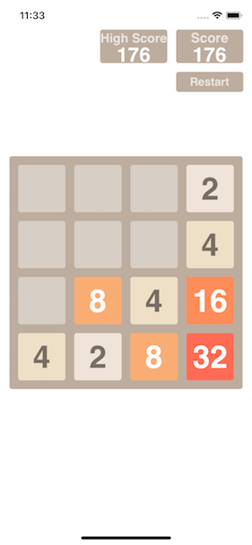
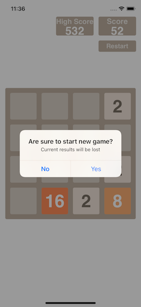
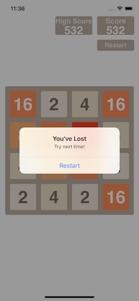

# 2048 for iOS

A native implementation of the 2048 puzzle game, written in Swift 4 with UIKit. Swipe to slide tiles and merge matching numbers toward 2048.

## Features

- A default 4 × 4 board with animated tile movement and merging.
- Current score and high score tracking.
- Automatic saving and restoration of the board with Core Data; scores are stored in UserDefaults.
- Restart confirmation and a game-over alert when no moves remain.
- Gameplay views built programmatically with Auto Layout. Storyboards provide the initial view controller and launch screen.

## Getting started

The Xcode project is configured for **Swift 4.0** and an **iOS 11.0** deployment target. You need macOS and Xcode to build and run the app. This is a legacy Swift project; newer toolchains may require source migration.

1. Clone or download this repository.
2. Open [2048.xcodeproj](./2048.xcodeproj) in Xcode.
3. Select the **2048** scheme and an iOS Simulator as the run destination.
4. Choose **Product → Run** (⌘R).

To run on a physical device, select your development team in the target's signing settings and use a unique bundle identifier if needed. The project uses Apple frameworks and requires no third-party dependency installation.

## How to play

- Swipe up, down, left, or right to move tiles in that direction.
- Matching tiles merge into one tile with twice the value, adding to your score.
- Keep combining tiles to reach 2048. The game ends when the board is full and no neighboring tiles can merge.
- Tap **Restart** and confirm to start a new game. Your high score is retained.

## Customization

In [ViewController.swift](./2048/Gameplay/Controllers/ViewController.swift), change the value returned by `dimensions` to set the number of rows and columns:

```swift
var dimensions: Int {
    return 4
}
```

The same controller defines `extraSpace` for tile spacing and `winValue` for the target tile value (2048 by default). Start a new game after changing the board size, since saved tiles retain their previous positions.

## Code overview

- [Controllers](./2048/Gameplay/Controllers): screen setup, swipe gestures, and game event handling.
- [Services](./2048/Gameplay/Services): movement, merging, scoring, and game-state logic.
- [Model](./2048/Gameplay/Model): tiles, positions, Core Data persistence, and score storage.
- [View](./2048/Gameplay/View): board rendering, tile animations, score displays, and visual styling.

## Screenshots

### Gameplay



### Restart confirmation



### Game over


